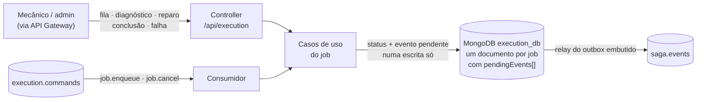

# oficina-execution-service

[](https://sonarcloud.io/summary/new_code?id=Luizustavo_oficina-execution-service) [](https://sonarcloud.io/summary/new_code?id=Luizustavo_oficina-execution-service) [](https://github.com/Luizustavo/oficina-execution-service/actions/workflows/ci.yml)

Execution Service da oficina mecânica (Tech Challenge SOAT, Fase 4): fila de execução e acompanhamento do diagnóstico e do reparo das ordens de serviço já pagas.

É um dos três microsserviços do sistema:

| Serviço | Responsabilidade | Banco |
|---|---|---|
| [`oficina-backend`](https://github.com/Luizustavo/oficina-backend) (OS Service) | Ordem de serviço, clientes, veículos, catálogo, estoque. **Orquestra a saga** | PostgreSQL (`oficina_db`) |
| [`oficina-billing-service`](https://github.com/Luizustavo/oficina-billing-service) | Orçamento, aprovação, pagamento e estorno | PostgreSQL (`billing_db`) + Redis |
| **`oficina-execution-service`** | Fila e andamento do reparo | MongoDB |

Os serviços conversam só por mensagens no RabbitMQ, seguindo o [contrato de mensagens](https://github.com/Luizustavo/oficina-backend/blob/main/docs/arquitetura/contratos-de-mensagens.md). Nenhum serviço acessa o banco de outro. A escolha do MongoDB está na [ADR-012](https://github.com/Luizustavo/oficina-backend/blob/main/docs/adr/adr-012-mongodb-no-execution-service.md).

## Arquitetura do serviço



**Banco e por quê.** O enunciado pede ao menos um banco NoSQL, e o Execution é o serviço com o dado menos relacional: cada job é **um documento** com os itens, a linha do tempo (`timeline`) e os eventos a publicar (`pendingEvents`), lido e gravado inteiro ([ADR-012](https://github.com/Luizustavo/oficina-backend/blob/main/docs/adr/adr-012-mongodb-no-execution-service.md)). Como uma escrita num único documento é atômica no MongoDB, mudar o status e enfileirar o evento é um só `updateOne`, sem precisar de transação nem de replica set.

## Rodando localmente

```bash
npm install
cp .env.example .env
docker run -d --name execution-mongo -p 27017:27017 mongo:8.0
npm run start:dev          # http://localhost:3000/api/execution/docs
```

Sem `RABBITMQ_URL` o serviço sobe com a mensageria desligada: os eventos ficam pendentes dentro dos jobs.

| Comando | O que faz |
|---|---|
| `npm test -- --coverage` | Testes unitários, cobertura mínima de 80% |
| `npm run test:e2e` | Sobe a aplicação e testa as rotas (precisa do MongoDB) |
| `npm run test:int` | Testes de integração com MongoDB e RabbitMQ de verdade (`MONGODB_URL`, `RABBITMQ_URL`) |
| `npm run lint` | ESLint + Prettier |

## Rotas

Todas com o prefixo `/api/execution`, que o Traefik usa para encaminhar ao serviço (ADR-015).

| Rota | Descrição |
|---|---|
| `GET /api/execution/health/live` e `/ready` | Probes do Kubernetes (públicas) |
| `GET /api/execution/docs` | Swagger |
| `GET /api/execution/queue` | Jobs em andamento: mais urgente primeiro, depois o mais antigo |
| `GET /api/execution/jobs/:id` | Job com a linha do tempo |
| `PATCH /api/execution/jobs/:id/start-diagnosis` | `QUEUED → DIAGNOSING`, publica `execution.job.started` |
| `PATCH /api/execution/jobs/:id/start-repair` | `DIAGNOSING → REPAIRING`, com as notas do diagnóstico (opcional). Não publica evento |
| `PATCH /api/execution/jobs/:id/finish` | `REPAIRING → DONE`, publica `execution.job.completed` com a duração |
| `PATCH /api/execution/jobs/:id/fail` | Qualquer status ativo → `FAILED`, com motivo (`PART_UNAVAILABLE`, `TECHNICAL_ISSUE`, `CUSTOMER_REQUEST`, `OTHER`) e detalhe. Publica `execution.job.failed`, e a saga estorna o cliente |

As rotas da fila exigem token da equipe com papel `MECHANIC` ou `ADMIN` (o mesmo JWT do OS Service). Uma ação fora de ordem responde 422; duas mudanças simultâneas no mesmo job, 409.

## Mensagens

Consome a fila `execution.commands` (comandos do OS Service) e publica em `saga.events`:

| Comando recebido | Resposta publicada |
|---|---|
| `execution.job.enqueue` | `execution.job.queued`. Repetido para a mesma OS: confirmado sem criar outro job. Payload inválido: direto para a DLQ |
| `execution.job.cancel` | `execution.job.canceled`. Repetido, ou com o job já encerrado, confirma de novo sem mudar o job. Se o job ainda não existe (o `enqueue` está em retentativa), o comando volta para retentativa |

Não há tabela de mensagens processadas: cada comando é idempotente pelo estado do job (ADR-012).

## Job de execução

Cada OS paga vira um job na fila:

```
QUEUED → DIAGNOSING → REPAIRING → DONE
   └──────────┴────────────┴──→ FAILED (mecânico registra a falha, com motivo)
   └──────────┴────────────┴──→ CANCELED (compensação da saga)
```

Cada mudança entra na linha do tempo do job (`timeline`), com quem fez e quando. O cancelamento é idempotente: cancelar de novo, ou cancelar um job já encerrado, não muda nada.

## MongoDB

Cada job é um documento da coleção `execution_jobs` (ADR-012). Índices:

| Índice | Para quê |
|---|---|
| `orderId` (único) | Uma OS tem um job só: um `execution.job.enqueue` repetido não cria outro |
| `status, priorityRank, createdAt` | A fila: mais urgente primeiro (`priorityRank` 0 = `HIGH`, 1 = `NORMAL`, 2 = `LOW`), depois o mais antigo |
| `relayLeaseUntil`, parcial em `pendingEvents.0` | O relay acha rápido só os jobs com evento a publicar |

**Outbox dentro do documento.** O MongoDB roda sem replica set, então não há transação entre documentos. O evento a publicar vai em `pendingEvents[]`, no mesmo documento do job: mudar o status e enfileirar o evento é um único `updateOne` (`$set` + `$push`), que é atômico. O relay (a cada segundo) reserva um job por vez (`relayLeaseUntil`, 30 s, para duas réplicas não publicarem o mesmo job ao mesmo tempo), publica os eventos dele em ordem e os remove com `$pull`. Se o broker recusar um evento, ele e os seguintes daquele job ficam para a próxima rodada.

**Concorrência.** Cada documento tem um `version`. Gravar exige que o `version` ainda seja o lido; se outra requisição mudou o job no meio do caminho, a gravação é recusada (HTTP 409 nas rotas, nova tentativa nas mensagens) em vez de sobrescrever a outra mudança.

## Variáveis de ambiente

| Variável | Obrigatória | Para quê |
|---|---|---|
| `MONGODB_URL` | sim | MongoDB `execution_db` (no cluster, montada pelo Deployment com a senha do `execution_user`) |
| `JWT_SECRET` | sim em produção | O mesmo segredo do OS e da Lambda de CPF; sem ele o serviço não sobe com `NODE_ENV=production` |
| `RABBITMQ_URL` | não | Sem ela a mensageria fica desligada e os eventos ficam pendentes nos jobs |
| `NEW_RELIC_LICENSE_KEY` | não | Liga a exportação de traces, métricas e logs (OpenTelemetry) |

## Testes e cobertura

| Métrica | Cobertura |
|---|---|
| Statements | 98,5% |
| Branches | 100% |
| Functions | 98,8% |
| Lines | 98,4% |

Mínimo de 80%, verificado pelo Jest e pelo Quality Gate do [SonarCloud](https://sonarcloud.io/summary/new_code?id=Luizustavo_oficina-execution-service) a cada PR. Os testes de integração rodam contra MongoDB e RabbitMQ de verdade no CI (outbox embutido, concorrência otimista, relay, consumidores), e os E2E testam as rotas com tokens JWT reais.

## CI/CD

Mesma esteira do `oficina-backend` ([esteira-ci-cd.md](https://github.com/Luizustavo/oficina-backend/blob/main/docs/arquitetura/esteira-ci-cd.md)): lint, testes unitários com cobertura de 80%, Quality Gate do SonarCloud, testes de integração (MongoDB e RabbitMQ) e E2E, build e smoke test da imagem. O merge na `main` dispara o deploy no k3s, com aprovação no Environment `production`.

## Kubernetes

Manifestos em [`k8s/`](k8s/README.md), no namespace `execution` (criado pelo `oficina-infra-k8s`).
